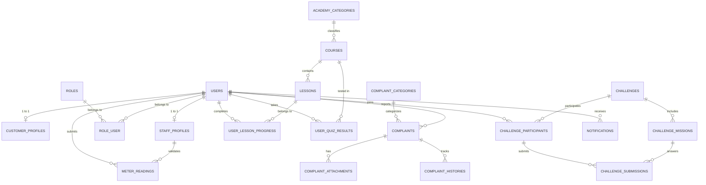

# DOKUMENTASI DATABASE MYSQL — SMART WATER
## Perumda Air Minum Tirta Sago Kota Payakumbuh

---

## 1. Konfigurasi Basis Data
- **Engine**: InnoDB
- **Charset / Collation**: `utf8mb4` / `utf8mb4_unicode_ci`
- **Nama Database Default**: `smart_water_payakumbuh`
- **ORM**: Laravel Eloquent ORM

---

## 2. Diagram Relasi Entitas (ERD)

---

## 3. Kamus Data Tabel

### Modul A: User & Profil
#### `users`
| Kolom | Tipe | Indeks / Keterangan |
| :--- | :--- | :--- |
| `id` | BIGINT UNSIGNED | PRIMARY KEY, AUTO_INCREMENT |
| `name` | VARCHAR(255) | Nama lengkap pengguna |
| `email` | VARCHAR(255) | UNIQUE |
| `password` | VARCHAR(255) | Bcrypt hash |
| `remember_token` | VARCHAR(100) | Nullable |
| `created_at`, `updated_at` | TIMESTAMP | |

#### `roles`
| Kolom | Tipe | Indeks / Keterangan |
| :--- | :--- | :--- |
| `id` | BIGINT UNSIGNED | PRIMARY KEY |
| `name` | VARCHAR(255) | UNIQUE (`admin`, `staff`, `customer`) |
| `display_name` | VARCHAR(255) | Nama tampilan peran |
| `description` | TEXT | Nullable |

#### `customer_profiles`
| Kolom | Tipe | Indeks / Keterangan |
| :--- | :--- | :--- |
| `id` | BIGINT UNSIGNED | PRIMARY KEY |
| `user_id` | BIGINT UNSIGNED | UNIQUE, FOREIGN KEY -> `users.id` (CASCADE) |
| `customer_id` | VARCHAR(255) | INDEX, Nomor sambungan pelanggan (10 digit) |
| `meter_number` | VARCHAR(255) | INDEX, Nomor seri meteran air |
| `tariff_category` | VARCHAR(255) | Contoh: `2A - Rumah Tangga Mandiri` |
| `phone` | VARCHAR(255) | Nomor kontak WhatsApp pelanggan |
| `address` | TEXT | Alamat sambungan rumah |
| `district` | VARCHAR(255) | Kecamatan (Payakumbuh Barat, Timur, Utara, dll.) |
| `zone` | VARCHAR(255) | Zona pipa distribusi (DIST-A, DIST-B, DIST-C) |
| `last_meter_value` | DECIMAL(10,2) | Stand meteran bulan lalu |
| `current_meter_value`| DECIMAL(10,2)| Stand meteran saat ini |
| `wallet_balance` | DECIMAL(14,2) | Saldo restitusi dompet |
| `points` | INT UNSIGNED | Poin pengalaman (XP) konservasi |

#### `staff_profiles`
| Kolom | Tipe | Indeks / Keterangan |
| :--- | :--- | :--- |
| `id` | BIGINT UNSIGNED | PRIMARY KEY |
| `user_id` | BIGINT UNSIGNED | UNIQUE, FOREIGN KEY -> `users.id` (CASCADE) |
| `nip` | VARCHAR(255) | UNIQUE, NIP Kedinasan PDAM Tirta Sago |
| `department` | VARCHAR(255) | Divisi operasional |
| `position` | VARCHAR(255) | Jabatan struktural / fungsional |
| `phone_dinas` | VARCHAR(255) | Kontak kedinasan |

---

### Modul B: Pusat Pengaduan (Service Center)
#### `complaint_categories`
| Kolom | Tipe | Indeks / Keterangan |
| :--- | :--- | :--- |
| `id` | BIGINT UNSIGNED | PRIMARY KEY |
| `name` | VARCHAR(255) | Nama kategori |
| `slug` | VARCHAR(255) | UNIQUE (`pipa_bocor`, `air_mati`, dll.) |
| `description` | TEXT | Deskripsi penanganan |
| `icon` | VARCHAR(255) | Kode icon Lucide |
| `is_active` | BOOLEAN | Status aktif kategori |

#### `complaints`
| Kolom | Tipe | Indeks / Keterangan |
| :--- | :--- | :--- |
| `id` | BIGINT UNSIGNED | PRIMARY KEY |
| `ticket_number` | VARCHAR(255) | UNIQUE, INDEX (`TK-PYK-YYYY-XXXX`) |
| `user_id` | BIGINT UNSIGNED | Nullable, FOREIGN KEY -> `users.id` (SET NULL) |
| `category_id` | BIGINT UNSIGNED | FOREIGN KEY -> `complaint_categories.id` |
| `reporter_name` | VARCHAR(255) | Nama pelapor |
| `contact_phone` | VARCHAR(255) | Nomor telepon aktif |
| `title` | VARCHAR(255) | Judul laporan |
| `description` | TEXT | Uraian lengkap kendala |
| `district` | VARCHAR(255) | Kecamatan lokasi kendala |
| `address` | TEXT | Alamat patokan fisik |
| `status` | VARCHAR(255) | `BARU`, `DIPROSES`, `MENUNGGU TINDAK LANJUT`, `SELESAI`, `DITOLAK` |
| `priority` | VARCHAR(255) | `RENDAH`, `NORMAL`, `TINGGI`, `DARURAT` |
| `assigned_to` | BIGINT UNSIGNED | Nullable, FOREIGN KEY -> `users.id` (Teknisi/Petugas yang ditugaskan) |
| `assigned_at` | TIMESTAMP | Nullable, Waktu penugasan teknisi |
| `resolved_at` | TIMESTAMP | Nullable, Waktu penyelesaian tiket |
| `resolution_notes` | TEXT | Nullable, Catatan teknis tindakan penyelesaian |
| `rejection_reason` | TEXT | Nullable, Alasan penolakan pengaduan jika ditolak |
| `deleted_at` | TIMESTAMP | Soft deletes |

#### `complaint_attachments`
| Kolom | Tipe | Indeks / Keterangan |
| :--- | :--- | :--- |
| `id` | BIGINT UNSIGNED | PRIMARY KEY |
| `complaint_id` | BIGINT UNSIGNED | FOREIGN KEY -> `complaints.id` (CASCADE) |
| `file_path` | VARCHAR(255) | Lokasi berkas di `storage/complaints/` |
| `file_name` | VARCHAR(255) | Nama asli berkas |
| `file_size` | BIGINT UNSIGNED| Ukuran berkas dalam bytes |
| `mime_type` | VARCHAR(255) | MIME type (image/jpeg, image/png, dll.) |

#### `complaint_histories`
| Kolom | Tipe | Indeks / Keterangan |
| :--- | :--- | :--- |
| `id` | BIGINT UNSIGNED | PRIMARY KEY |
| `complaint_id` | BIGINT UNSIGNED | FOREIGN KEY -> `complaints.id` (CASCADE) |
| `actor_name` | VARCHAR(255) | Nama aktor pembaru status |
| `actor_user_id`| BIGINT UNSIGNED | Nullable, FOREIGN KEY -> `users.id` |
| `status` | VARCHAR(255) | Status peralihan |
| `note` | TEXT | Catatan progres lapangan |

---

### Modul C: Pembacaan Meter AI-OCR
#### `meter_readings`
| Kolom | Tipe | Indeks / Keterangan |
| :--- | :--- | :--- |
| `id` | BIGINT UNSIGNED | PRIMARY KEY |
| `report_number` | VARCHAR(255) | UNIQUE, INDEX (`REP-04-XXXX`) |
| `user_id` | BIGINT UNSIGNED | Nullable, FOREIGN KEY -> `users.id` |
| `meter_number` | VARCHAR(255) | INDEX |
| `reading` | DECIMAL(10,2) | Angka stand meteran saat ini (m³) |
| `previous_reading`| DECIMAL(10,2)| Angka stand meteran sebelumnya (m³) |
| `consumption` | DECIMAL(10,2) | Kubikasi pemakaian (m³) |
| `estimated_cost`| DECIMAL(12,2) | Estimasi biaya tagihan (Rp) |
| `customer_name`| VARCHAR(255) | Nama pelanggan |
| `zone` | VARCHAR(255) | Zona pipa |
| `photo_path` | VARCHAR(255) | Lokasi foto odometer |
| `status` | VARCHAR(255) | `Menunggu Validasi`, `Terverifikasi AI`, `Ditolak` |
| `validated_by` | BIGINT UNSIGNED | Nullable, FOREIGN KEY -> `users.id` |
| `validated_at` | TIMESTAMP | Nullable |
| `rejection_reason`| TEXT | Nullable |
| `deleted_at` | TIMESTAMP | Soft deletes |

---

### Modul D: Akademi Air & Tantangan
- **`academy_categories`**: Klasifikasi materi literasi air.
- **`courses`**: Modul kursus air bersih (`course-1`, `course-2`, dll.).
- **`lessons`**: Bab bacaan kursus dengan urutan terstruktur.
- **`user_lesson_progress`**: Rekam jejak bacaan per pengguna.
- **`user_quiz_results`**: Skor kuis, XP yang diperoleh, dan status kelulusan.
- **`challenges`**: Program tantangan konservasi air mingguan.
- **`challenge_missions`**: Misi harian berbobot XP.
- **`challenge_participants`**: Pendaftaran tantangan per pengguna.
- **`challenge_submissions`**: Rekam penyelesaian misi dan bukti pendukung.

---

### Modul E: Notifikasi
#### `notifications`
| Kolom | Tipe | Indeks / Keterangan |
| :--- | :--- | :--- |
| `id` | BIGINT UNSIGNED | PRIMARY KEY |
| `user_id` | BIGINT UNSIGNED | FOREIGN KEY -> `users.id` (CASCADE) |
| `type` | VARCHAR(255) | `BILL`, `METER`, `SERVICE`, `SYSTEM` |
| `title` | VARCHAR(255) | Judul pemberitahuan |
| `desc` | TEXT | Isi pesan notifikasi |
| `link` | VARCHAR(255) | Tautan halaman rujukan |
| `is_read` | BOOLEAN | Status sudah dibaca |
| `read_at` | TIMESTAMP | Waktu pembacaan |
