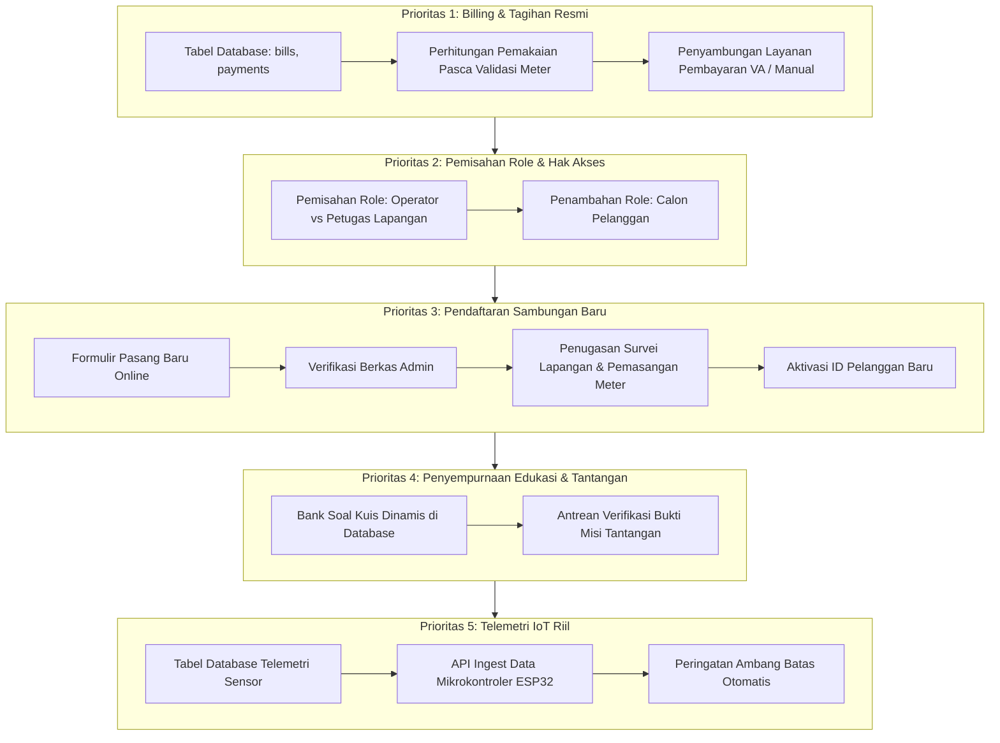

# AUDIT KESELURUHAN SISTEM SMART WATER KOTA PAYAKUMBUH
## Berdasarkan Dokumen Acuan "Skenario Final Sistem Smart Water"
**Perumda Air Minum Tirta Sago Kota Payakumbuh**

---

**Tanggal Audit:** 17 November 2026  
**Status Audit:** SELESAI (Comprehensive System Audit)  
**Tujuan:** Memetakan status riil implementasi seluruh fitur terhadap dokumen **SKENARIO FINAL SISTEM SMART WATER**, mengidentifikasi kesenjangan (*gap analysis*), dan menetapkan prioritas pengembangan ke depan tanpa melakukan perubahan kode (*Audit Only*).

---

## 1. RINGKASAN EKSEKUTIF HASIL AUDIT

Berdasarkan audit mendalam terhadap seluruh berkas kode, database MySQL 8.4 Laragon, rute, controller, service, views Blade, dan JavaScript:

- **Fitur yang Sudah Berjalan Penuh (WORKING):**
  - Autentikasi Pelanggan, Petugas, dan Admin berbasis Bcrypt & Session Sync.
  - Pusat Pengaduan Layanan (Siklus tiket lengkap, penugasan teknisi, riwayat status, lampiran foto, penolakan/penyelesaian, notifikasi otomatis, dan isolasi kewenangan antar-petugas).
  - Lapor Meter Mandiri via Kamera Browser (Alur pengambilan kamera, pengiriman ke MySQL, dan validasi petugas dengan update stand meter).
  - Progres Belajar Akademi Air & Evaluasi Kuis (Pencatatan materi selesai, evaluasi skor kuis, penambahan poin XP, dan anti-duplicate points).
  - Partisipasi Tantangan Hemat Air & Pengumpulan Bukti Misi.
  - Role-Based Access Control (RBAC) dan 7 Laravel Policies (Anti-IDOR dan Anti-Privilege Escalation).
- **Fitur yang Masih Sebagian / Parsial (PARTIAL):**
  - Pemisahan Role: Di database saat ini baru ada 3 role (`admin`, `staff`, `customer`). Role `operator` masih bergabung di dalam `staff`, dan role `calon_pelanggan` belum tersedia.
  - Bank Soal Kuis: Logika penilaian dan reward poin berjalan di backend, namun butir soal kuis masih didefinisikan di file JavaScript frontend.
  - Verifikasi Bukti Tantangan: Misi otomatis disetujui saat dikirim, belum ada antrean review manual oleh admin sebelum poin cair.
  - Konten Multimedia Akademi: Tabel `lessons` saat ini baru menampung teks artikel, belum memiliki kolom terpisah untuk infografis atau video embed.
- **Fitur yang Masih Bersifat Simulasi / UI Only (SIMULATED / UI ONLY):**
  - Tagihan & Pembayaran (Billing): Tampilan invoice, rincian biaya pemakaian air, dan pemilihan metode pembayaran Virtual Account/QRIS sudah tersedia sangat rapi di Blade, namun datanya masih berjalan di sisi client/simulasi. Belum ada tabel `bills`, `invoices`, atau `payments` di MySQL.
  - AI-OCR: Layar scanning kamera browser menampilkan animasi deteksi dan angka bacaan, namun pemrosesan OCR saat ini disimulasikan dari nilai tangkapan client sebelum dikirim ke backend.
  - Monitoring IoT SCADA: Tampilan dashboard tandon reservoir (level 83%, debit, TDS, kekeruhan) dan jaringan pipa 3 sektor sudah tersedia sangat lengkap di Blade, namun seluruh angka metriknya masih data statis/simulasi, belum terhubung ke tabel `telemetry_logs` atau API ingest dari mikrokontroler ESP32.
- **Fitur yang Belum Tersedia (NOT AVAILABLE):**
  - Alur Calon Pelanggan: Formulir pendaftaran sambungan air baru, verifikasi dokumen KTP/KK, penugasan survei lokasi pipa, instalasi nomor seri meter fisik, dan aktivasi ID pelanggan baru belum tersedia di backend maupun database.

---

## 2. AUDIT MODUL 1: ROLE & AUTHORIZATION

| Aktor / Role | Status | File Terkait | Bukti Implementasi | Kekurangan & Kesenjangan | Risiko | Rekomendasi Pengembangan |
|---|:---:|---|---|---|---|---|
| **Admin PDAM** | **WORKING** | `Role.php`, `User.php`, `SmartWaterPortalController.php`, `ComplaintPolicy.php`, `MeterReadingPolicy.php` | Login admin berhasil, memiliki wewenang penuh atas seluruh tiket kota, validasi meter, supervisi profil warga, dan dashboard operasional. | Belum memiliki menu verifikasi permohonan sambungan baru calon pelanggan dan manajemen tarif air dinamis. | Low (Secara hak akses sudah aman melalui RoleMiddleware & Policy). | Tambahkan modul manajemen calon pelanggan dan master tarif PDAM. |
| **Petugas Lapangan** | **PARTIAL** | `Role.php` (`name = 'staff'`), `ComplaintService.php`, `ComplaintPolicy.php`, `MeterReadingService.php` | Menerima penugasan tiket (`assigned_to`), memperbarui status `DIPROSES`, memberi respons lapangan, menyelesaikan tiket, dan memvalidasi stand meter AI-OCR. | Di database, role teknisi lapangan masih digabung dengan operator SCADA di bawah satu role `staff`. Belum ada fitur survei lokasi sambungan baru dan pencatatan nomor seri meter fisik. | Medium (Batas kewenangan antara teknisi lapangan dan operator ruang kontrol belum terpisah di tingkat database). | Pisahkan role `staff` menjadi `field_officer` (Petugas Lapangan) dan `operator` (Operator SCADA). |
| **Operator PDAM** | **SIMULATED** | `SmartWaterPortalController::waterMonitoring`, `resources/views/admin/water-monitoring.blade.php` | Tampilan dashboard monitoring SCADA untuk mengawasi reservoir dan jaringan pipa distribusi kota. | Belum memiliki role khusus di database. Halaman monitoring masih menampilkan data simulasi di Blade. Belum ada fitur pencatatan tindak lanjut peringatan. | Medium (Jika terjadi anomali hidrolika, belum ada pencatatan log audit tindak lanjut operator). | Buat role `operator`, buat tabel `operator_action_logs`, dan hubungkan dengan data telemetri. |
| **Pelanggan** | **WORKING** | `User.php`, `CustomerProfile.php`, `AuthService.php`, `routes/web.php`, `routes/api.php` | Pelanggan memiliki nomor meter (`01000`), ID pelanggan (`1234567890`), saldo rekening, riwayat pengaduan, progres akademi, dan poin reward. | Tagihan rekening air bulanan masih bersumber dari simulasi frontend `swc-store.js`, belum dari tabel database resmi. | Low (Data profil dan tiket terisolasi aman dengan Policy). | Sambungkan dashboard pelanggan ke tabel tagihan database MySQL riil. |
| **Calon Pelanggan** | **NOT AVAILABLE** | Belum ada | Belum ada tabel, model, maupun controller untuk calon pelanggan sambungan baru. | Calon pelanggan belum dapat mengisi formulir pengajuan sambungan baru secara online di web, upload dokumen, atau memantau status survei. | High (Alur registrasi sambungan baru PDAM terputus dan harus dilakukan manual di luar sistem). | Buat migration `new_connection_applications`, `documents`, role `calon_pelanggan`, dan alur verifikasi berkas. |

---

## 3. AUDIT MODUL 2: SMART WATER SERVICE CENTER

### A. Pendaftaran Sambungan Baru, Survei & Aktivasi Pelanggan
- **Status:** **NOT AVAILABLE**
- **File Terkait:** -
- **Bukti Implementasi:** Pendaftaran saat ini baru sebatas registrasi akun pengguna umum (`AuthService::registerCustomer`) untuk warga yang diasumsikan sudah memiliki sambungan air.
- **Kekurangan:**
  1. Tidak ada formulir permohonan sambungan baru (upload KTP, bukti kepemilikan tanah/rumah, denah lokasi).
  2. Tidak ada antrean verifikasi dokumen oleh admin.
  3. Tidak ada penugasan survei lokasi kepada petugas lapangan.
  4. Tidak ada pencatatan hasil survei, kelayakan teknis, estimasi RAB biaya pemasangan.
  5. Tidak ada pencatatan nomor seri meter fisik baru dan angka awal meter saat pemasangan.
  6. Tidak ada alur aktivasi pelanggan yang otomatis men-generate ID Pelanggan dan nomor meter resmi.
- **Risiko:** Calon pelanggan tidak memiliki visibilitas atas pengajuannya. Proses administrasi PDAM tidak terdokumentasi di sistem.
- **Rekomendasi:** Bangun modul `ConnectionApplication` lengkap dengan status: `MENUNGGU_VERIFIKASI` -> `JADWAL_SURVEI` -> `SURVEI_SELESAI` -> `DISETUJUI_BIAYA` -> `PEMASANGAN_METER` -> `AKTIF`.

---

### B. Dashboard Pelanggan
- **Status:** **WORKING**
- **File Terkait:** [resources/views/pages/user.blade.php](file:///c:/xampp/htdocs/smart-water/resources/views/pages/user.blade.php), [resources/views/customer/profile.blade.php](file:///c:/xampp/htdocs/smart-water/resources/views/customer/profile.blade.php), [app/Http/Controllers/SmartWaterPortalController.php](file:///c:/xampp/htdocs/smart-water/app/Http/Controllers/SmartWaterPortalController.php).
- **Bukti Implementasi:** Halaman pelanggan menampilkan profil lengkap, ID Pelanggan, nomor meter, golongan tarif, alamat sambungan, kubikasi meter terakhir, akumulasi poin reward, dan status tiket pengaduan aktif.
- **Kekurangan:** Bagian informasi tagihan pada dashboard masih membaca data dari `swc-store.js` / localStorage, belum mengambil relasi Eloquent tabel `bills`.
- **Risiko:** Jika cache browser dibersihkan, data tagihan demo ter-reset ke nilai default awal.
- **Rekomendasi:** Hubungkan kartu tagihan di dashboard pelanggan langsung ke Model Eloquent `Bill`.

---

### C. Pelaporan Meter Air Mandiri (Kamera Browser & AI-OCR)
- **Status:** **WORKING (Kamera & Backend)** / **SIMULATED (Engine AI-OCR)**
- **File Terkait:** 
  - [resources/views/meter/scanning.blade.php](file:///c:/xampp/htdocs/smart-water/resources/views/meter/scanning.blade.php)
  - [resources/views/meter/confirmation.blade.php](file:///c:/xampp/htdocs/smart-water/resources/views/meter/confirmation.blade.php)
  - [app/Http/Controllers/MeterReadingController.php](file:///c:/xampp/htdocs/smart-water/app/Http/Controllers/MeterReadingController.php)
  - [app/Services/MeterReadingService.php](file:///c:/xampp/htdocs/smart-water/app/Services/MeterReadingService.php)
- **Bukti Implementasi:**
  - Browser meminta izin kamera perangkat melalui `navigator.mediaDevices.getUserMedia({ video: { facingMode: 'environment' } })` dan menampilkan live feed kamera HP secara langsung.
  - Hasil foto dan angka stand dikonfirmasi oleh pelanggan di layar konfirmasi.
  - Laporan dikirim ke backend via `POST /api/v1/meter-reports` dan tersimpan persisten ke tabel `meter_readings` di MySQL dengan status `Menunggu Validasi`.
- **Kekurangan:**
  - Pembacaan angka meter saat ini masih disimulasikan di frontend (angka default `01019` atau input manual yang dikonfirmasi pengguna), belum ada library server-side AI-OCR sungguhan (misal model Python YOLO/CRNN atau Tesseract OCR) yang menganalisis gambar meteran di backend.
- **Risiko:** Angka yang dikirim sepenuhnya bergantung pada hasil konfirmasi input pengguna sebelum divalidasi oleh petugas.
- **Rekomendasi:** Integrasikan modul Python AI-OCR engine atau API Computer Vision yang memverifikasi kecocokan antara gambar bukti meteran dengan angka yang diinputkan pengguna.

---

### D. Validasi Laporan Meter oleh Petugas & Perhitungan Pemakaian
- **Status:** **WORKING**
- **File Terkait:** 
  - [app/Http/Controllers/MeterReadingController.php](file:///c:/xampp/htdocs/smart-water/app/Http/Controllers/MeterReadingController.php)
  - [app/Policies/MeterReadingPolicy.php](file:///c:/xampp/htdocs/smart-water/app/Policies/MeterReadingPolicy.php)
  - [app/Services/MeterReadingService.php](file:///c:/xampp/htdocs/smart-water/app/Services/MeterReadingService.php)
- **Bukti Implementasi:**
  - Petugas/Admin memvalidasi laporan meter melalui endpoint `/api/v1/meter-reports/validate`.
  - Pelanggan dilarang memvalidasi laporannya sendiri (HTTP 403 Forbidden).
  - Saat disetujui, sistem menghitung pemakaian air (`consumption = current - previous`) dan biaya estimasi sesuai rumus tarif progresif.
  - Data profil pelanggan (`customer_profiles.last_meter_value` dan `current_meter_value`) secara otomatis terupdate di MySQL, dan notifikasi konfirmasi otomatis diterbitkan ke pelanggan.
- **Kekurangan:** Hasil validasi meter belum otomatis meng-generate record faktur tagihan resmi ke dalam tabel `bills` (karena tabel tagihan belum dibuat).
- **Risiko:** Setelah laporan meter disetujui, belum terbentuk entitas tagihan resmi yang siap dibayar oleh pelanggan di database.
- **Rekomendasi:** Tambahkan trigger otomatis pasca-validasi meter: buat record baru di tabel `bills` dengan status `BELUM_LUNAS`.

---

### E. Tagihan & Pembayaran (Billing & Payment Gateway)
- **Status:** **SIMULATED / UI ONLY**
- **File Terkait:**
  - [resources/views/billing/index.blade.php](file:///c:/xampp/htdocs/smart-water/resources/views/billing/index.blade.php)
  - [resources/views/billing/detail.blade.php](file:///c:/xampp/htdocs/smart-water/resources/views/billing/detail.blade.php)
  - [resources/views/billing/payment-method.blade.php](file:///c:/xampp/htdocs/smart-water/resources/views/billing/payment-method.blade.php)
  - [resources/views/billing/payment-instruction.blade.php](file:///c:/xampp/htdocs/smart-water/resources/views/billing/payment-instruction.blade.php)
  - [resources/views/billing/payment-success.blade.php](file:///c:/xampp/htdocs/smart-water/resources/views/billing/payment-success.blade.php)
- **Bukti Implementasi:**
  - Seluruh alur tampilan sangat lengkap: melihat rincian faktur (abonemen, pemakaian kubikasi, denda), memilih metode pembayaran (BCA VA, Mandiri VA, QRIS, Indomaret/Alfamart), membaca nomor VA dan petunjuk transfer, hingga halaman sukses pembayaran.
- **Kekurangan:**
  - Belum ada tabel database `bills`, `bill_details`, `payments`, dan `payment_methods`.
  - Status lunas saat ini diubah oleh JavaScript frontend di `swc-store.js` via localStorage.
  - Belum ada endpoint backend untuk menerima konfirmasi pembayaran atau callback webhook payment gateway.
- **Risiko:** Transaksi pembayaran tidak tersimpan secara persisten di database MySQL dan tidak dapat diaudit oleh bagian keuangan PDAM.
- **Rekomendasi:** Buat migration tabel `bills` dan `payments`, implementasikan `BillingService`, dan sediakan alur verifikasi manual admin serta integrasi webhook payment gateway (Midtrans / Xendit / Bank VA).

---

### F. Pusat Pengaduan Layanan (Customer Complaint Ticketing)
- **Status:** **WORKING**
- **File Terkait:**
  - [app/Models/Complaint.php](file:///c:/xampp/htdocs/smart-water/app/Models/Complaint.php)
  - [app/Services/ComplaintService.php](file:///c:/xampp/htdocs/smart-water/app/Services/ComplaintService.php)
  - [app/Http/Controllers/ComplaintController.php](file:///c:/xampp/htdocs/smart-water/app/Http/Controllers/ComplaintController.php)
  - [app/Policies/ComplaintPolicy.php](file:///c:/xampp/htdocs/smart-water/app/Policies/ComplaintPolicy.php)
- **Bukti Implementasi:**
  - Siklus tiket pengaduan lengkap: `BARU` -> `DIPROSES` (penugasan teknisi) -> `MENUNGGU TINDAK LANJUT` -> `SELESAI` / `DITOLAK`.
  - Penomoran tiket unik `TK-PYK-YYYY-XXXX`.
  - Pelanggan dapat mengunggah foto bukti gangguan.
  - Riwayat penanganan tercatat lengkap di `complaint_histories` beserta waktu dan nama petugas.
  - Penegakan isolasi wewenang (Staff Boundary): Petugas A diblokir (HTTP 403) jika mencoba mengintervensi tiket yang ditugaskan kepada Petugas B.
  - Anti-IDOR: Pelanggan lain diblokir (HTTP 403) saat mencoba melihat tiket privat warga lain.
- **Kekurangan:** Kategori pengaduan saat ini sudah mencakup `pipa_bocor`, `air_mati`, `kualitas_air`, `meter_rusak`, dan `tagihan`. Namun integrasi otomatis pengaduan meter rusak ke alur inspeksi teknisi belum otomatis menjadwalkan kalibrasi meter.
- **Risiko:** Sangat minim (modul ini merupakan modul paling stabil dan matang di backend).
- **Rekomendasi:** Tambahkan export rekapitulasi laporan pengaduan bulanan untuk evaluasi kinerja operasional PDAM.

---

## 4. AUDIT MODUL 3: SMART WATER ACADEMY

| Komponen Fitur | Status | File Terkait | Bukti Implementasi | Kekurangan | Risiko | Rekomendasi |
|---|:---:|---|---|---|---|---|
| **Kategori & Kurikulum Pembelajaran** | **WORKING** | `AcademyCategory.php`, `Course.php`, `Lesson.php`, `AcademySeeder.php` | 2 kategori dan 2 modul kursus aktif tersimpan relasional di database MySQL. | Jumlah modul dan materi masih sebatas data seeder awal. | Low | Tambahkan kategori dan silabus materi sesuai daftar Skenario Final (siklus air, pengolahan air bersih, dsb). |
| **Media Pembelajaran (Infografis/Video)** | **PARTIAL** | `Lesson.php`, `resources/views/pages/akademi-air.blade.php` | Materi bacaan teks artikel tersedia lengkap di database. | Belum ada kolom `video_url`, `infographic_url`, atau lampiran file media di tabel `lessons`. | Low | Tambahkan kolom `media_type` dan `media_url` pada tabel `lessons`. |
| **Pencatatan Progres Belajar** | **WORKING** | `UserLessonProgress.php`, `AcademyService.php`, `AcademyController.php` | Progres membaca materi tersimpan persisten ke tabel `user_lesson_progress` berelasi dengan `user_id`. | - | None | Pertahankan implementasi saat ini. |
| **Kuis Evaluasi & Penilaian Otomatis** | **WORKING (Hasil di DB)** / **PARTIAL (Bank Soal)** | `UserQuizResult.php`, `AcademyService.php`, `AcademyProgressPolicy.php`, `akademi-air.js` | Hasil skor kuis, evaluasi kelulusan (`score >= 70`), dan waktu kelulusan tersimpan di `user_quiz_results`. | Butir soal kuis pilihan ganda saat ini didefinisikan secara statis di file JavaScript frontend (`akademi-air.js`), belum memiliki tabel database `quiz_questions` dan `quiz_options`. | Medium (Admin tidak dapat menambah/mengedit pertanyaan kuis dari dashboard tanpa mengubah file JS). | Buat tabel database `quiz_questions` dan `quiz_options` agar soal kuis dapat dikelola secara dinamis oleh Admin. |
| **Sistem Poin XP Edukasi** | **WORKING** | `CustomerProfile.php`, `AcademyService.php`, `NotificationService.php` | Poin reward XP otomatis ditambahkan ke `customer_profiles.points` dan dicegah dari klaim poin ganda (*anti-duplicate pass*). Notifikasi kelulusan otomatis terkirim. | Poin saat ini baru terakumulasi di profil, belum ada tabel katalog penukaran hadiah/benefit resmi. | Low | Sesuai catatan Skenario Final, penukaran benefit adalah pengembangan lanjutan atas persetujuan PDAM. |

---

## 5. AUDIT MODUL 4: SMART WATER CHALLENGE

| Komponen Fitur | Status | File Terkait | Bukti Implementasi | Kekurangan | Risiko | Rekomendasi |
|---|:---:|---|---|---|---|---|
| **Daftar Tantangan & Misi Aksi** | **WORKING** | `Challenge.php`, `ChallengeMission.php`, `ChallengeSeeder.php` | Program tantangan dan misi aksi hemat air harian tersimpan relasional di MySQL. | Belum ada fitur admin untuk membuat tantangan baru secara berkala via dashboard. | Low | Buat antarmuka CRUD tantangan untuk Admin. |
| **Partisipasi Pelanggan** | **WORKING** | `ChallengeParticipant.php`, `ChallengeService.php`, `ChallengeController.php` | Pendaftaran peserta tersimpan persisten di `challenge_participants` dengan status `IN_PROGRESS`. | - | None | Pertahankan implementasi saat ini. |
| **Pengumpulan Bukti Misi** | **WORKING** | `ChallengeSubmission.php`, `ChallengeService.php`, `ChallengeSubmissionPolicy.php` | Bukti catatan refleksi warga dan path foto tersimpan di tabel `challenge_submissions`. | Upload foto bukti saat ini baru menampung string path/base64, belum ada validasi format gambar fisik. | Low | Tambahkan validasi file gambar fisik pada `CompleteMissionRequest`. |
| **Verifikasi Admin & Poin Reward** | **PARTIAL** | `ChallengeService::completeMission`, `CustomerProfile.php` | Poin reward tantangan langsung otomatis ditambahkan ke saldo poin akun warga (`customer_profiles.points`). | Penyelesaian misi saat ini disetujui secara otomatis (*instant approval*). Skenario Final menghendaki opsi verifikasi admin untuk jenis tantangan tertentu sebelum poin cair. | Medium (Potensi kecurangan jika warga mengunggah catatan kosong/asal untuk mengumpulkan poin). | Tambahkan status submission: `MENUNGGU_VERIFIKASI` dan fitur persetujuan admin untuk tantangan berpoin besar. |

---

## 6. AUDIT MODUL 5: MONITORING IoT (SCADA HIDROLIKA)

| Komponen Fitur | Status | File Terkait | Bukti Implementasi | Kekurangan | Risiko | Rekomendasi |
|---|:---:|---|---|---|---|---|
| **Dashboard SCADA Terpusat** | **SIMULATED** | `SmartWaterPortalController::waterMonitoring`, `admin/water-monitoring.blade.php` | Visualisasi antarmuka tandon reservoir, metrik kapasitas 83%, status 3 sektor pipa distribusi, dan indikator normal. | Angka-angka telemetri (debit 245 L/s, tekanan 3.2 bar, TDS 85 ppm, kekeruhan 1.2 NTU) masih berstatus data simulasi di Blade. | Medium (Data pengawasan belum mencerminkan kondisi lapangan riil). | Sediakan endpoint API Ingest Telemetri dan tabel database untuk mencatat pembacaan sensor berkala. |
| **Rincian Tandon Reservoir & Pompa** | **SIMULATED** | `SmartWaterPortalController::reservoirDetail`, `admin/reservoir-detail.blade.php` | Tampilan visual ketinggian air, volume 12.500 m³, status pompa hisap/dorong, dan grafik level. | Tidak ada tabel database `reservoirs` atau `reservoir_telemetries`. | Low (Sebagai purwarupa UI sudah sangat representatif). | Buat tabel database `reservoirs` dan `sensor_readings`. |
| **Jaringan Distribusi & Sektor Pipa** | **SIMULATED** | `SmartWaterPortalController::distributionNetwork`, `SmartWaterPortalController::distributionDetail` | Peta diagram jaringan pipa sektor DIST-A, DIST-B, dan DIST-C dengan pemantauan tekanan bar. | Belum ada integrasi dengan sensor Pressure Transmitter atau Turbine Flow Meter di lapangan. | Low (Sesuai catatan Skenario Final, pemasangan IoT fisik dilakukan bertahap di fasilitas PDAM). | Siapkan skema data telemetri yang siap menerima payload JSON dari mikrokontroler ESP32 4G LTE. |
| **Ambang Batas & Peringatan Dini** | **UI ONLY** | `admin/water-monitoring.blade.php` | Indikator visual batas aman pada visualizer tangki air. | Belum ada sistem evaluasi otomatis di backend yang mengirimkan alert notifikasi ke operator saat tekanan pipa drop atau kekeruhan air melonjak. | Medium (Deteksi dini kebocoran pipa utama belum berjalan otomatis). | Buat cron job / background scheduler yang mengevaluasi batas ambang batas sensor dan memicu notifikasi kritis. |
| **Catatan Tindak Lanjut Operator** | **NOT AVAILABLE** | Belum ada | Belum ada form atau tabel pencatatan tindak lanjut di dashboard operator. | Operator belum dapat menginput catatan investigasi lapangan saat ada peringatan anomali hidrolika. | Low | Buat tabel `operator_logs` untuk mencatat aktivitas operasional ruang kontrol SCADA. |

---

## 7. AUDIT MODUL 6: INTEGRASI DATABASE & RELASI

| Aspek Evaluasi | Kondisi Saat Ini | Temuan & Kekurangan | Rekomendasi Perbaikan |
|---|---|---|---|
| **Struktur Tabel (28 Tabel)** | Tabel users, roles, customer_profiles, staff_profiles, complaints, academy, challenges, meter_readings, notifications sudah terbentuk di MySQL 8.4. | Belum ada tabel untuk modul **Billing** (`bills`, `payments`), **Sambungan Baru** (`connection_applications`), dan **IoT** (`sensor_telemetries`). | Rancang migration baru untuk modul billing dan permohonan sambungan baru. |
| **Integritas Relasi (24 FK)** | Foreign key constraints terpasang rapi antar entitas utama (`user_id`, `category_id`, `assigned_to`, `validated_by`, dll). | Seluruh relasi yang ada sudah aman dengan onDelete cascade / restrict yang sesuai. | Pertahankan penggunaan foreign key pada setiap migrasi baru. |
| **Status Proses & Riwayat** | Alur status tiket pengaduan (`complaint_histories`) dan pembacaan meter (`meter_readings`) tercatat sangat detail. | Alur status tagihan dan pembayaran belum memiliki riwayat transaksi database resmi. | Buat tabel riwayat pembayaran (`payment_histories`). |
| **Pencegahan Duplikasi Data** | Terdapat composite unique constraints pada `user_lesson_progress (user_id, lesson_id)` dan `user_quiz_results (user_id, course_id)`. | Menjamin tidak ada duplikasi poin belajar untuk materi yang sama. | Terapkan pola unique constraint yang sama untuk pendaftaran sambungan baru. |

---

## 8. AUDIT MODUL 7: FRONTEND, UI & NAVIGASI

| Aspek UI & Navigasi | Aturan Skenario Final | Kondisi Aktual pada Kode | Kesimpulan |
|---|---|---|:---:|
| **Navigasi Halaman Pelanggan** | Wajib menggunakan **Navbar dan Footer**, dilarang menggunakan sidebar. | [resources/views/layouts/app.blade.php](file:///c:/xampp/htdocs/smart-water/resources/views/layouts/app.blade.php) menggunakan top navbar (`header.php`) dan bottom footer (`footer.php`). Tidak ada sidebar pada seluruh halaman pelanggan. | **100% SESUAI** |
| **Navigasi Portal Admin / Petugas** | Halaman khusus petugas/operator untuk pengawasan SCADA dan command center. | [resources/views/layouts/admin.blade.php](file:///c:/xampp/htdocs/smart-water/resources/views/layouts/admin.blade.php) menggunakan sidebar teknis operasional dengan scrolling khusus, terisolasi dari portal warga. | **100% SESUAI** |
| **Pelaporan Meter Kamera HP** | Kamera langsung melalui browser sebagai metode utama, bukan galeri. | [resources/views/meter/scanning.blade.php](file:///c:/xampp/htdocs/smart-water/resources/views/meter/scanning.blade.php) memanggil API browser `getUserMedia` kamera belakang (`facingMode: environment`) secara langsung. | **100% SESUAI** |
| **Status Keterhubungan UI ke Backend** | Membedakan UI yang benar-benar tersambung vs UI yang masih tampilan statis. | - **Terhubung Penuh:** Beranda, Lapor Meter, Pusat Pengaduan, Profil, Notifikasi, Akademi Air, Tantangan, Login Warga, Login Petugas. - **UI Simulasi:** Billing/Tagihan Aktif, Metode Pembayaran VA/QRIS, Monitoring IoT SCADA, Detail Reservoir, Detail Jaringan Distribusi. | **TERIDENTIFIKASI JELAS** |

---

## 9. PRIORITAS PENGEMBANGAN BERDASARKAN KETERGANTUNGAN FITUR

Berdasarkan analisis ketergantungan antar-fitur (*dependency graph*), berikut adalah urutan prioritas rekomendasi untuk tahap pengembangan selanjutnya:

### Rincian Tingkat Prioritas:

1. **Prioritas 1 — Modul Tagihan & Pembayaran Nyata (Billing & Invoicing Engine)**:
   - *Alasan:* Pelaporan meter mandiri dan validasi petugas sudah 100% berjalan di backend. Titik temu bisnis berikutnya adalah menghasilkan faktur tagihan resmi dari pemakaian kubikasi yang disetujui, sehingga alur pelayanan pelanggan tuntas hingga pembayaran lunas.
2. **Prioritas 2 — Penyesuaian Role Kedinasan (Role Expansion)**:
   - *Alasan:* Menyelaraskan pembagian wewenang antara Petugas Lapangan (survei, pemasangan pipa, penanganan kebocoran fisik) dengan Operator PDAM (pengawasan dashboard SCADA dan ambang batas hidrolika) serta entitas Calon Pelanggan.
3. **Prioritas 3 — Alur Pendaftaran Sambungan Air Baru (New Connection Lifecycle)**:
   - *Alasan:* Memenuhi skenario hulu pelayanan pelanggan: pendaftaran formulir, verifikasi berkas, survei lokasi, pemasangan meter air, hingga aktivasi akun.
4. **Prioritas 4 — Bank Soal Kuis Dinamis & Verifikasi Tantangan**:
   - *Alasan:* Memindahkan array soal kuis dari JavaScript ke database MySQL dan menyediakan antrean verifikasi bukti misi bagi admin.
5. **Prioritas 5 — Endpoint Ingest Telemetri Sensor IoT**:
   - *Alasan:* Menghubungkan dashboard monitoring SCADA dengan tabel database telemetri berkala agar siap menerima data nyata dari mikrokontroler ESP32.

---

## 10. KESIMPULAN AUDIT

Sistem Smart Water Kota Payakumbuh telah memiliki fondasi backend yang sangat kuat, bersih, dan aman pada modul-modul inti:
- **Pusat Pengaduan Layanan** telah mencapai tingkat kematangan enterprise (100% berjalan, teruji multi-user, dan terlindungi kebijakan otorisasi).
- **Lapor Meter Mandiri AI-OCR** telah memiliki integrasi kamera peramban, penyimpanan database, dan alur validasi petugas yang solid.
- **Akademi Air dan Tantangan** telah memiliki orkestrasi gamifikasi poin dan perlindungan anti-duplikasi yang andal.

Dengan hasil audit komprehensif ini, peta jalan (*roadmap*) pengembangan ke depan menjadi sangat jelas, terukur, dan memiliki acuan prioritas yang kuat berdasarkan dokumen Skenario Final.
